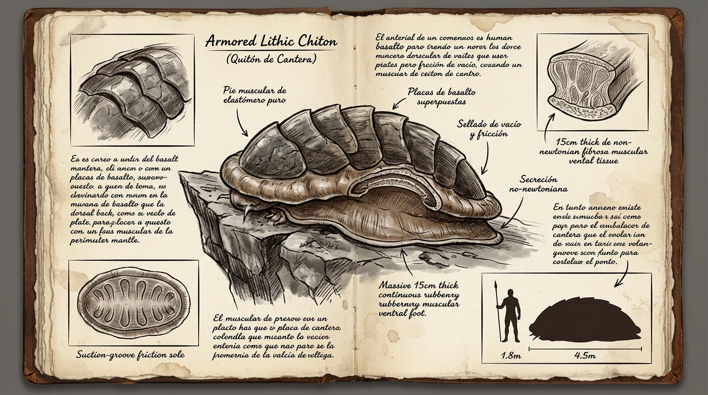

# 🐚 Kólmor — Quitón de Cantera (*Q'ara Llip'i*)

---

## 📋 FICHA TÉCNICA Y ECOLÓGICA

* **Nombre común (en la frontera / talleres de convoy):** Kólmor / Quitón de cantera / Losa de marea seca / Lapa de basalto.
* **Nombre en Lengua Vieja:** *Q'ara Llip'i* (del quechua: *q'ara*, «piel dura / corteza» + *llip'i*, «agarre resbaloso / ventosa que sujeta con fuerza»).
* **Zona y Bioma:** Zona 1 y 2 — Escarpes verticales de andesita, grietas basálticas húmedas y taludes de cantera expuestos a niebla de esporas.
* **Clasificación de Amenaza:** **Clase D** (Herbívorolitófago pasivo; nula hostilidad activa, peligro exclusivamente por masa estática o derrumbe).
* **Tamaño en escala humana:**
  * **Longitud total:** 4,5 metros (silueta ovalada y aplanada).
  * **Anchura máxima:** 2,6 metros («ancho como dos carromatos de carga pesada»).
  * **Altura sobre el sustrato:** 1,10 a 1,30 metros (vientre pegado a la pared o al suelo sin patas elevadas).
  * **Masa estimada:** 3,8 toneladas (placas dorsales hipermineralizadas + masa muscular ventral densa).
* **Nicho ecológico:** Herbívoro lito-filtrador masivo. Desincrusta colonias de líquenes ferruginosos y algas de roca mediante una rádula córnea circular que gira como una broca de diamante.

---

## 🔬 BIOMECÁNICA Y ADAPTACIONES DEL FLUJO

### 1. El Pie Muscular Ventral de 15 cm (Elastómero Continuo No-Newtoniano)
* **La física del tejido:** Toda la base ventral del Kólmor es un único músculo monolítico continuo sin articulaciones, huesos intermedios ni fascias segmentadas.
* **Comportamiento No-Newtoniano:** La dermis del pie contiene micro-conductos capilares cargados de una secreción coloidal densa rica en Flujo osmótico. 
  * Al desplazarse lentamente (1 a 2 km/h), el pie es suave, adaptable y gomoso, copiando las grietas del relieve para sellar el vacío.
  * Si un filo de obsidiana o un impacto cinético violento golpea la base, la presión hidrodinámica bloquea los microfilamentos en 0,02 segundos: la energía de corte se reparte horizontalmente por toda la masa del animal sin penetrar ni desgarrar.

### 2. Ocho Placas Dorsales de Basalto Articulado
* El dorso está protegido por ocho grandes segmentos transversales de queratina basáltica superpuesta que encajan como tejas romanas.
* Permite al animal flexionarse sobre aristas cóncavas o convexas de roca, manteniendo siempre el pie muscular sellado al sustrato.

---

## 👁️ SENTIDOS Y PAUTAS DE DEFENSA

* **Sentidos dominantes:**
  * **Quimiorrecepción y presión:** Detecta humedad mineral y cambios de presión atmosférica a través del manto periférico.
  * **Cero ojos convencionales:** Presenta micro-estemas fotosensibles en las junturas de las placas dorsales que perciben variaciones de sombra cenital.
* **Pauta defensiva («Sellado de Vacío»):**
  * Ante vibraciones de depredadores (como el *Acorazado de la Cresta*), el Kólmor no huye: contrae el borde periférico del manto contra la roca y genera una depresión de vacío absoluta. Cuatro toneladas selladas por vacío sobre roca viva resultan imposibles de arrancar o voltear.
* **Reacción al Pozo Muerto:**
  * Letargo absoluto e inofensivo. Al no depender de fibras musculares rápidas, el campo de Quietud simplemente ralentiza su avance a milímetros por hora.

---

## 🛠️ EXPLOTACIÓN LOGÍSTICA: LA MOQUETA DE GOMA DE FRONTERA

En los talleres del Gobierno en las Sombras y los convoyes de vanguardia, el Kólmor es el recurso de fricción más codiciado de la Clase D:
1. **Cosecha limpia sin desperdicio:** Al abatir al animal mediante descargas de percusión entre las junturas de las placas, los mecánicos no tienen que despiezar huesos: **despellejan el pie ventral completo como una alfombra continua de elastómero puro de 4,5 × 2,5 metros y 15 cm de grosor**.
2. **Suelas de oruga para Bastiones Móviles:** La moqueta se corta con sierras circulares pesadas en losas rectangulares que se atornillan a las orugas metálicas. Absorben impactos de 40 toneladas y ofrecen agarre insuperable en paredes de barro y pedregal.
3. **Bandas de rodadura macizas para los Wayra:** Se tornean en aros macizos impinchables que garantizan tracción absoluta a más de 300 km/h en roca mojada.

---

## 📖 PROTOCOLO NARRATIVO DE APARICIÓN (4 TIEMPOS)

* **Tiempo 1 (Rastro):** Una pared vertical de basalto donde una franja de dos metros y medio de ancho ha quedado completamente limpia de líquenes, con surcos circulares concéntricos pulidos como mármol.
* **Tiempo 2 (Señal):** Un crujido húmedo y sordo, similar al despegue de una ventosa de tonelada contra el barro (*¡schhh-plop!*), seguido por el tintineo de gravilla aplastada.
* **Tiempo 3 (Presencia parcial):** Un saliente rocoso que no figuraba en las cartas; las ocho tejas de basalto gris parecen estratos geológicos hasta que una exhalación pesada levanta vaho en el borde inferior.
* **Tiempo 4 (Revelación):** La mole se desprende de la pared con una lentitud implacable, revelando el borde del pie muscular carmesí y negro que tiembla mientras busca nuevo apoyo.
