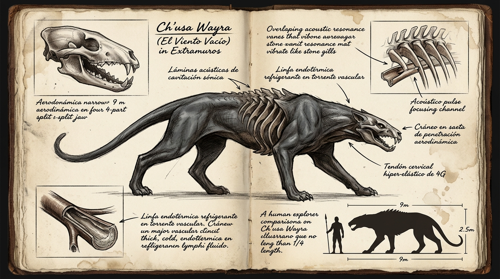

# 🌪️ Ch'usa Wayra (*El Viento Vacío*)



---

## 📋 FICHA TÉCNICA Y ECOLÓGICA

* **Nombre común (en la frontera / destacamentos militares):** Estrangulador de viento / Segador fugaz / Tríada de cañón / El Viento Vacío.
* **Nombre en Lengua Vieja:** *Ch'usa Wayra* (del quechua: *ch'usaq*, «vacío / ausencia / silente» + *wayra*, «viento / vendaval veloz»). Designa a los depredadores que cizallan el aire al converger.
* **Zona y Bioma:** Zona 1 y 2 — Desfiladeros de viento, cornisas de la dorsal basáltica, cañones estrechos y gargantas de roca fracturada.
* **Clasificación de Amenaza:** **Clase B-alta** (Cazadores en tríada coordinada; letalidad extrema por convergencia multidireccional y velocidad de escape).
* **Tamaño en escala humana (por individuo):**
  * **Longitud total:** 7,5 a 8,2 metros (desde el hocico en cuña hasta la punta de la cola estabilizadora).
  * **Altura a la cruz:** 2,1 a 2,3 metros (vientre suspendido bajo, hombros musculados y compactos).
  * **Masa estimada:** 3,8 a 4,5 toneladas por ejemplar (silueta estilizada, comprimida lateralmente y de bajísima resistencia aerodinámica).
* **Estructura social y caza:** **Estrictamente en tríadas (grupos de 3 individuos)**. Nunca cazan en solitario; un ejemplar desparejado rehúye el combate y busca unirse a otra pareja o perece por ineficiencia calórica.

---

## 🔬 BIOMECÁNICA: LA FÍSICA DE LA CAZA FUGAZ

A diferencia de los depredadores pesados de choque (como el Acorazado, que se traba en combate cuerpo a cuerpo), el *Ch'usa Wayra* opera bajo una doctrina de **incursión cinética pura a alta velocidad (*Hit & Run*)**.

### 1. El Triángulo de Convergencia (La Implosión Barométrica a más de 300 km/h)
* **La táctica de lanzamiento:** Al detectar una presa o un convoy ligero en el fondo del cañón, los tres individuos se posicionan en cornisas separadas formando un triángulo equilátero perfecto (a 120 grados entre sí).
* **La embestida supersónica:** Se lanzan en picado sincronizado por las paredes verticales de basalto, aprovechando la gravedad y la inyección masiva de *Caudal* biológico en el tren trasero para acelerar de 0 a **280–320 km/h** en menos de tres segundos (con picos instantáneos de **350 km/h** al entrar en el túnel aerodinámico de baja presión).
* **El colapso de presión (*El Efecto Ch'usa*):**
  * Los tres proyectiles vivos de 4 toneladas convergen en el mismo punto a más de **85 metros por segundo**.
  * Al pasar rozando a la presa con milésimas de segundo de diferencia, el desplazamiento masivo de aire generado por sus tres perfiles en cuña provoca una **implosión barométrica de vacío instantánea en el epicentro**.
  * **El daño:** La víctima sufre una descompresión súbita que le colapsa los pulmones, revienta sus capilares timpánicos y la derriba contra el suelo. En ese mismo instante de aturdimiento ciego, los espolones óseos de los tres ejemplares asestan cortes de cizalla al pasar por inercia.

### 2. Dispersión, Ocultamiento y Re-ataque Angular
* Tras el pase, las bestias **no frenan**: aprovechan la inercia de más de 300 km/h para remontar las paredes opuestas del cañón y perderse en las fisuras superiores en menos de dos segundos.
* **La linfa endotérmica:** Gracias a su fluido vascular refrigerante (que absorbe el calor metabólico sin hervir), los animales no sufren agotamiento térmico tras el sprint, permitiéndoles sostener persecuciones a esta velocidad durante horas.
* **Segunda y tercera oleada:** En cuestión de diez o doce segundos, reorganizan el triángulo desde **nuevas alturas y ángulos imprevistos**, repitiendo la embestida fugaz hasta que las defensas de la presa colapsan.

---

## ⚔️ EL UMBRAL DE COMBATE: LA BARRERA DE LA CLASE B (5.000–50.000 UC)

En la historia de *Extramuros*, el *Ch'usa Wayra* es la criatura que define la **frontera de supervivencia militar**. Muestra exactamente por qué un civil o explorador común perece, y qué se requiere fisiológicamente para resistir:

```
                  [CH'USA 1] (120°)
                     \
                      \  300+ km/h
                       \
                        ▼
   [CH'USA 2] ────────▶ [COMBATIENTE] ◀──────── [CH'USA 3]
   (300+ km/h)          (Epicentro)             (300+ km/h)
```

1. **La Aniquilación de la Clase D y C (<5.000 UC):**
   * A más de 85 metros por segundo, la física ocular y neurológica de una persona común (o de exploradores como Nina y Makusi) es incapaz de procesar la amenaza. 
   * Para cuando el cerebro registra el silbido de caída, la bestia ya ha cruzado el camino. La onda de vacío derriba a los hombres y el corte por inercia los parte en dos antes de que puedan activar su Flujo defensivo.
2. **La Respuesta de un Operador de Clase B-alta (30.000–40.000 UC):**
   * Un veterano militar o un operador del Cuerpo de Contención que opere en este rango experimenta la verdadera **aceleración de procesamiento neural (dilatación temporal)**. 
   * A esa frecuencia de Flujo, el ataque a 300 km/h deja de ser una mancha invisible y se convierte en tres vectores cinéticos definidos.
   * **Lectura del Triángulo:** El combatiente Clase B sabe que tirarse a un lado es arrojarse a la trayectoria del flanco adyacente. Se planta con **Quietud de ancla en el tren inferior** para absorber la implosión barométrica sin caerse y alinea su lanza de choque neumático o arma pesada hacia el vértice más cercano.
3. **Colapso de la Tríada:**
   * La coordinación de la manada depende de la simetría absoluta. En el instante en que **uno de los tres ejemplares es impactado, frenado o abatido**, el triángulo de vacío colapsa. Dos individuos no pueden sostener la implosión barométrica envolvente; al perder la ventaja de velocidad y desconcierto, los dos supervivientes abortan de inmediato la emboscada y huyen por el desfiladero.
4. **Por qué el Gobierno creó el Interceptor Wayra:**
   * Combatir a pie contra depredadores de 4 toneladas a más de 300 km/h causaba bajas masivas incluso entre tropas de élite Clase B.
   * La creación del vehículo *Wayra* (dotado de la misma linfa endotérmica, ruedas de Kólmor y turbina de 3.000 CV) permitió al Gobierno igualar la balanza: **poner a sus pilotos Clase B a 350–400 km/h dentro de una cabina blindada** para cazar a las bestias con su misma velocidad y arrebatarles el control de los desfiladeros.

---

## 🏎️ LA DOCTRINA MILITAR DE LOS INTERCEPTORES *WAYRA*

El Gobierno en las Sombras no solo copió los materiales biológicos de la criatura; **copió literalmente su velocidad y su táctica de caza**:

* **Velocidad Paritaria:** Los 300–400 km/h del interceptor *Wayra* son la replicación mecánica directa de los 280–350 km/h que el animal alcanza en picado.
* **El «Tridente de Escolta»:** Los interceptores militares *Wayra* se despliegan **invariablemente en escuadrones de tres vehículos**, emulando la tríada del *Ch'usa Wayra*.
* **La Maniobra de Enlace:** Al interceptar convoyes fugitivos o bestias de gran tonelaje, los tres *Wayra* ejecutan el cerco triangular a más de 300 km/h, usando sus difusores aerodinámicos para encajonar y desestabilizar al blanco exactamente como lo hace la manada en los cañones.

---

## 📖 PROTOCOLO NARRATIVO DE APARICIÓN (4 TIEMPOS)

* **Tiempo 1 (Rastro):** Un desfiladero silencioso con restos de una caravana volcada; los camiones presentan impactos laterales en tres direcciones opuestas con hendiduras paralelas de espolón óseo a dos metros de altura.
* **Tiempo 2 (Señal):** Un chasquido rítmico que no viene de un solo sitio: tres silbidos de aire en frecuencias ligeramente distintas que rebotan entre las paredes del cañón (*ch'usss... ch'usss... ch'usss...*), anunciando que el triángulo se ha cerrado.
* **Tiempo 3 (Presencia parcial):** El polvo del cañón se levanta simultáneamente en tres puntos altos de la roca; tres siluetas oscuras agazapadas que flexionan los cuartos traseros a la vez.
* **Tiempo 4 (Revelación):** Un estallido de piedra y tres sombras alargadas que caen en picado a velocidad de vértigo, convergiendo hacia el centro del camino con el sonido ensordecedor de un vacío repentino que succiona el aire del pecho.
