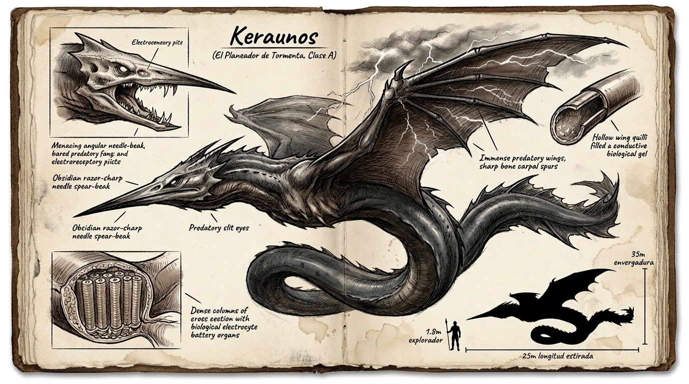

# ⚡ Keraunos (*Illapa Asiru*)



---

## 📋 FICHA TÉCNICA Y ECOLÓGICA

* **Nombre común (en la frontera / destacamentos militares):** Keraunos / Anguila de tormenta / El Devorador de Rayos / La Saeta de Nube.
* **Nombre en Lengua Vieja:** *Illapa Asiru* (del quechua: *illapa*, «rayo / trueno celestial» + *asiru*, «serpiente / anguila»). Designa a la sierpe alada que devora la cólera del cielo.
* **Zona y Bioma:** Frentes de tormenta convectiva severa, estrato superior del dosel arbóreo y gargantas atmosféricas entre la Zona 1, Zona 2 y las fronteras del Horizonte Oscuro.
* **Clasificación de Amenaza:** **CLASE A (Catastrófica Condicional)**.
  * **Por qué NO es Clase S:** No genera esa potencia devastadora por sí mismo. No invoca los rayos ni dobla las leyes del clima; simplemente aprovecha la atmósfera de Extramuros y ofrece su cuerpo como el **camino de menor resistencia** para absorber las descargas naturales. Sin tormenta activa, sufre una severa torpeza metabólica y queda vulnerable en tierra.
* **Dimensiones en Escala Humana:**
  * **Longitud total:** 25 metros (desde la punta del pico hasta el extremo de la aleta caudal).
  * **Envergadura alar:** 32 a 35 metros (alas estrechas, rígidas y afiladas de planeador de alta altitud).
  * **Morfología y Cuerpo Anguíliforme:** Silueta serpentina y musculosa de 25 metros, con cuero oscuro abisal color pizarra, quillas dorsales afiladas como navajas y aleta caudal dentada.
  * **Cráneo Depredador en Aguja:** Cabeza angulosa y agresiva sin cuello aviar que se proyecta en un **pico-lanza de obsidiana negra pulida**, con ojos rasgados de pupila vertical y una hilera de colmillos de anclaje translúcidos en la base interior de las mandíbulas.
  * **Alas Predadoras de Tormenta:** 32 a 35 metros de envergadura; alas de planeador afiladas dotadas de espolones óseos carpales y quillas tubulares huecas rellenas de gel superconductor.
* **Nicho ecológico:** Depredador aéreo de frente de borrasca. Cabalga las supercélulas de tormenta como una sombra invisible; cuando acumula carga crítica y divisa una presa terrestre de gran calibre, se descuelga de las nubes en picado mudo, descarga su energía en un radio devastador y remonta hacia la tormenta para recargarse.

---

## 🔬 BIOMECÁNICA Y LA FÍSICA DE LA ABSORCIÓN

El Keraunos es la culminación de la **Ley de Poder: biología extrema de adaptación, no magia abstracta**.

### 1. El Pararrayos Vivo y el Blindaje de Flujo
* **Plumas Tubulares con Gel Conductor:** Su plumaje no es de queratina común. Cada pluma es un **tubo cilíndrico hueco relleno de un gel coloidal biológico altamente conductor**. Estas plumas actúan como una malla de jaula de Faraday externa.
* **El Flujo como Aislante Tisular:** Cuando un rayo de millones de voltios cae en el frente de tormenta, el animal desciende y ofrece su cuerpo como la ruta más fácil hacia tierra. Su *Caudal* biológico interviene manteniendo los vasos sanguíneos y órganos vitales polarizados para que la corriente fluya a través del gel y las bandas periféricas **sin cocer sus tejidos internos**.
* **Bandas de Órganos Electrocíticos (Baterías Biológicas):** A lo largo de los flancos y el vientre discurren cordones de células electrocíticas apiladas en serie y paralelo. Funcionan como condensadores gigantes capaces de **almacenar entre 30 y 50 impactos de rayo directos**.

---

## 💥 LA DESCARGA RADIAL: ESCALA Y RADIOS DE DESTRUCCIÓN

Dado que un relámpago medio transfiere aproximadamente **1 gigajulio (GJ)** de energía, acumular de 30 a 50 rayos concentra una energía equivalente a **7 a 12 toneladas de explosivo militar (TNT)**.

Al caer en picado sobre un objetivo, el Keraunos clava su pico en tierra o descarga a escasos metros del suelo liberando toda la energía acumulada en una **onda expansiva eléctrica y de sobrepresión radial**:

```
[0m] ──── (60m: Letalidad Absoluta) ──── (200m: Devastación Térmica) ──── (400m: Onda de Choque) ──── (+500m)
```

* **0 a 60 metros (Zona de Letalidad Inmediata):** Arcos voltaicos ramificados de millones de voltios y onda de choque barométrica masiva. **Mata instantáneamente a cualquier usuario de Clase D o C**, y destruye casi con total seguridad a un combatiente de Clase B. Los metales se sueldan y los depósitos de combustible de vehículos estallan.
* **60 a 200 metros (Zona de Destrucción Térmica y Mecánica):** Quemaduras de tercer grado, vaporización instantánea de la savia en árboles colosales (que estallan como granadas de madera astillada), vegetación calcinada y muerte de fauna media.
* **200 a 400 metros (Zona de Conmoción y Barotrauma):** Rotura de tímpanos, conmoción cerebral severa por el trueno, ceguera temporal por el destello ultravioleta y pérdida súbita de la conciencia.
* **Más de 500 metros:** Fogonazo cegador y estampido de trueno atronador sin daño letal por arco.

---

## 👁️ EL SENSORIO DE CAUDAL: «EL FARO Y LA QUIETUD»

* **El Caudal como Cartel Luminoso:**
  * El Keraunos posee fosetas electrorreceptoras en la base del pico y a lo largo de la mandíbula capaces de percibir campos bioeléctricos diminutos a kilómetros de distancia.
  * Si un humano o un vehículo activa un **Caudal alto** (aumentando la actividad neuronal, el pulso cardíaco y la emisión iónica), en la oscuridad de la tormenta brilla como una **antorcha encendida**. El Keraunos lo detecta inmediatamente como una presa prioritaria.
* **La Quietud como Única Salvación:**
  * Ante la presencia de un Keraunos en la tormenta, encender motores o activar defensas de Flujo es una condena a muerte.
  * La única forma de sobrevivir es el apagado total: **entrar en Quietud absoluta**, reducir el ritmo cardíaco, enfriar la temperatura corporal y dejar que la tormenta ruede por encima sin que la bestia perciba señal alguna.

---

## 🛠️ EXPLOTACIÓN LOGÍSTICA: EL MATERIAL PARA CONVOYES Y BASES

Abatir un Keraunos (tarea reservada exclusivamente a emboscadas preparadas por escuadrones de Clase A humano cuando la bestia aterriza sin carga tras una tormenta) proporciona los recursos energéticos más codiciados de Extramuros:

1. **Filamentos de Gel Conductor (Cableado de Cero Resistencia):**
   * El gel de sus plumas tubulares se extrae y encapsula en mangueras de caucho para construir los tendidos eléctricos de alta tensión de **Puerto Raíz** y el cableado de ignición de las turbinas pesadas de 4.000 CV. No sufre pérdidas por calor ni interferencias por esporas.
2. **Placas de Electrocitos (Baterías de Almacenamiento Estático):**
   * Los bloques de órganos electrocíticos se estabilizan químicamente como **capacitores biológicos de alta densidad**. Instalados en los *Bastiones Móviles*, permiten acumular energía captada de pararrayos durante las tormentas para alimentar sistemas de percusión y soldadura pesada en travesías de meses.
3. **Piel Dieléctrica Aislante:**
   * La membrana exterior que recubre su vientre posee una constante dieléctrica insuperable. Se usa para forrar el habitáculo y las cabinas de los convoyes militares, convirtiéndolos en **jaulas de Faraday móviles** inmunes a descargas eléctricas de la fauna exterior.

---

## 📖 PROTOCOLO NARRATIVO DE APARICIÓN (4 TIEMPOS)

* **Tiempo 1 (Rastro):** Un claro de bosque carbonizado en un círculo perfecto de doscientos metros; árboles partidos en astillas con la madera magnetizada y agujas de brújula que giran desorientadas en los salpicaderos.
* **Tiempo 2 (Señal):** Un frente de nubes negras que avanza a contracorriente del viento; dentro de la tormenta, los relámpagos no caen hacia el suelo, sino que son absorbidos horizontalmente hacia un punto ciego que no emite trueno inmediato.
* **Tiempo 3 (Presencia parcial):** Un destello azulado ilumina la panza de las nubes y revela momentáneamente la silueta de una serpiente alada de treinta metros planeando sin batir las alas; los vellos de los brazos de los soldados se erizan y el metal de las armas comienza a zumbar con fuego de San Telmo.
* **Tiempo 4 (Revelación):** La bestia quiebra el dosel en un picado silencioso a doscientos kilómetros por hora, su pico en aguja apuntando al centro del convoy mientras las bandas de su vientre resplandecen con un brillo cegador que convierte la noche en mediodía.
