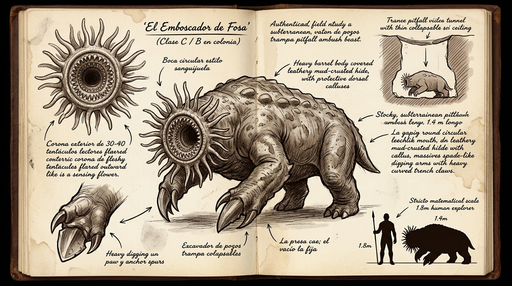

# 🐾 Tigmo, «El Emboscador de Fosa» (*T'uqu Hap'iq*)



---

## 1. Identificación

| Campo | Dato |
|---|---|
| Nombre de campo | Tigmo (del griego *thígma*, «tacto») |
| Apodos | El Lector, Boca de Embudo, La Estrella Ciega, El Emboscador de Fosa |
| Nombre en Lengua Vieja | *T'uqu Hap'iq* («el que agarra en el agujero») `[VERIFICAR]` |
| Zona | Zona 1. Suelos húmedos del Bosque de los Ecos, turba negra bajo basalto fracturado, accesos inferiores a la Cueva de los Huesos |
| Hábito | Solitario o en campo de fosas. Depredador de emboscada |

**Nota de etimología.** Las raíces propuestas son *t'uqu* («agujero, hueco») y *hap'iq* («el que agarra», de *hap'iy*, «agarrar, atrapar»). Se descarta *llank'ana*, que significa «herramienta de trabajo» y no describe el agarre. Verificar la forma y la ortografía con un diccionario quechua-español o con un hablante antes de fijarla en el texto.

---

## 2. Nivel de amenaza

La C.L.A.S.E. se reserva al personal humano y militar. La fauna se describe con un nivel de amenaza ecológico.

| Situación | Nivel de amenaza ecológico |
|---|---|
| Ejemplar solitario en fosa | Equivalente a Clase C, alto |
| Colonia (4 a 8 fosas conectadas) | Equivalente a Clase B |

*Por qué sube en colonia:* Las fosas comparten galerías, el terreno cede por secciones y un grupo que se separa tiene dificultad para volver sobre sus pasos.

---

## 3. Morfología

| Medida | Valor |
|---|---|
| Longitud total (de la corona a la base de la cola) | 1,4 a 1,6 m |
| Altura en galería horizontal | 0,55 a 0,65 m |
| Anchura | unos 0,7 m |
| Masa | 95 a 130 kg |
| Diámetro de la boca | 22 a 28 cm |

- **Cuerpo.** Achaparrado, en forma de tonel, de musculatura anular. La cutícula es gruesa, segmentada y elástica, con cerdas cortas que segregan un sebo que repele la tierra.
- **Patas delanteras.** Dos palas curvas con garras gruesas, capaces de cortar raíces y conglomerado blando. Son sus herramientas de excavación y de cierre del agarre.
- **Boca.** Circular, sin mandíbulas articuladas. Es un esfínter muscular forrado por 3 o 4 anillos concéntricos de dientes córneos curvados hacia dentro, con una lengua raspadora en el centro.
- **Corona sensorial.** Una orla de 30 a 40 tentáculos de 20 a 25 cm alrededor de la boca, con órganos de Eimer y terminales sensoriales. Sin protección ósea ni córnea.
- **Ojos.** Atrofiados. No son funcionales.

---

## 4. La fosa

| Parte | Dato |
|---|---|
| Forma | Cámara cónica excavada desde abajo |
| Profundidad (del techo a la base) | 0,8 a 1,2 m |
| Diámetro en el techo | 0,8 a 1,0 m `[PROPUESTO]` |
| Techo | Capa de turba, musgo y raicillas de 4 a 8 cm |
| Posición de la boca | Orientada hacia arriba, a **0,5 a 0,7 m bajo el techo** `[PROPUESTO]` |

```
 superficie    ~~ hojarasca / musgo ~~
 techo falso   ========= 4-8 cm =========
                \                     /
                 \    cámara cónica  /     <- 0,8-1,2 m de profundidad total
                  \   [corona+boca] /      <- boca a 0,5-0,7 m del techo
                   \______________/
                          |
                  galería de acceso        <- aquí queda doblado el cuerpo
```

**Cota de la boca.** La cámara mide hasta 1,2 m, pero la boca no está en la base. El cuerpo del animal se dobla en la galería que sale del fondo, y eso deja la boca a 0,5-0,7 m del techo. Esa cota es la que explica que una pierna se hunda hasta la rodilla o el medio muslo antes de tocar la corona. Si la boca estuviera en la base, la pierna llegaría a la cadera.

**Funcionamiento del techo.** Responde a masa física pura. Aguanta a un roedor o a un ave, y cede bajo un adulto con peso o con carga. La fosa se arma sola y la presa no necesita estar en movimiento.

---

## 5. Secuencia de captura

1. **Hundimiento.** El techo cede. La presa no cae entera: una extremidad se hunde hasta la rodilla o el medio muslo, y el equilibrio se pierde.
2. **Contacto.** El animal permanece quieto hasta que la pierna toca la corona. El contacto con los tentáculos centrales es el gatillo. No ataca a distancia.
3. **Cierre de la boca.** La boca sube y envuelve la extremidad. Los anillos de dientes rotan hacia dentro y se clavan en espiral.
4. **Retención mecánica.** La retención principal la dan los dientes, que apuntan hacia dentro y no permiten sacar la pierna tirando.
5. **Cierre estanco.** El esfínter se contrae y sella el contorno. Esa succión muscular **complementa** el agarre: impide que entre aire y que la presa gire, pero no sostiene el peso. No hay cifra de vacío irreal.
6. **Cierre de las palas.** Las patas delanteras emergen del lecho y abrazan la extremidad por fuera.
7. **Tracción.** El animal tira hacia abajo, a ritmo pausado, y el suelo suelto de la fosa se desploma sobre la presa.

**Efecto según la presa.**
- Animal pequeño o mediano (jabalí, venado): la tracción termina de hundirlo.
- Humano adulto: lo habitual es inmovilización, laceración profunda de la pierna y arrastre parcial. El colapso del terreno sobre el torso solo asfixia si la víctima cae de bruces dentro de la fosa.

---

## 6. Percepción y lectura por Flujo

- **Percepción pasiva (vibración).** Con la corona pegada al suelo, detecta pisadas pesadas a unos **10 m** `[PROPUESTO]`. Le basta para mantenerse quieto o armar la fosa.
- **Lectura fina (tensión).** Solo **por contacto**. Con la corona y los anillos sobre la extremidad, lee la tensión muscular de la presa y calcula hacia dónde empuja. Esa lectura decide cuándo apretar y tirar.
- **Cómo se pierde.** La lectura depende de que la presa ofrezca resistencia. Si desaparece el vector de resistencia, el animal no tiene sobre qué corregir.
- **Límites.** Sin contacto con el suelo, o con ruido fuerte y continuo (lluvia intensa, estampida), la percepción pasiva cae drásticamente.

---

## 7. Metabolismo

- **En espera.** Bradicárdico. Reduce el pulso y el gasto al mínimo, y puede pasar **días en espera** (de varios días a un par de semanas) `[PROPUESTO]`.
- **En ataque.** Gasta casi toda la reserva en una explosión anaeróbica de **unos cinco minutos**. Pasado ese tiempo se agota.
- **Si falla el agarre.** Abandona la fosa. El techo roto la deja inservible, y el animal necesita enterrarse y alimentarse de lombrices e invertebrados de la turba para recuperarse. Rehacer una fosa le lleva **días** `[PROPUESTO]`.
- **Consecuencia ecológica.** Explica que sea solitario y que un campo de fosas esté activo solo en parte.

---

## 8. Vulnerabilidades

| Punto débil | Detalle |
|---|---|
| **Corona** | Sin protección. Un corte de machete o una lasca de piedra en los tentáculos provoca un colapso sensorial y suelta la presa. |
| **Inmovilidad en el fondo** | No maniobra de lado. Si la presa no cae sobre la boca, tarda 2 o 3 segundos en reorientarse. |
| **Agotamiento** | Tras unos cinco minutos de agarre y lectura, su reserva se vacía. |
| **Fuego** | Ver sección siguiente. Funciona, pero con riesgo grave. |

### Fuego en la turba

Prender fuego a una fosa funciona a corto plazo: el calor hace que la corona suelte. Pero la turba es combustible, y en una atmósfera rica en oxígeno la combustión es más vigorosa.

- Puede iniciar una **combustión latente subterránea** (*smouldering*) sin llama visible, que arde durante **semanas**.
- Señales: humo bajo, olor acre a turba quemada, suelo caliente y, más tarde, **hundimientos** donde la turba se ha consumido.
- Peligros para quien lo provoca: gases en las galerías, suelo que cede sin aviso y fuego que reaparece en superficie lejos del origen.
- Peligros para el bosque: puede extenderse bajo raíces y aflorar donde nadie lo espera.

---

## 9. Cómo se evita y cómo se sobrevive

### A. Evitar la fosa: lectura del terreno

El techo responde al peso, no a cómo se camina. La **Quietud no sirve para esto**: no cambia la masa de quien pisa. Se evita con lectura de indicios:

- Comba cóncava en la turba.
- Ausencia de lombrices e insectos en la hojarasca de ese tramo.
- Vara de tanteo delante del paso. Un techo de 4 a 8 cm suena hueco y cede al empujar.
- Pisar sobre raíces, roca o madera caída en vez de sobre turba limpia.
- Rodear los tramos sospechosos. Una fosa suele tener otras cerca.

### B. Sobrevivir al agarre: Quietud

Cuando el agarre ya se ha cerrado, forcejear empeora todo: cada tirón da al animal un vector de resistencia que leer, y la tracción aumenta.

- Al **destensar la musculatura del muslo** y mantener el cuerpo flojo, el Tigmo pierde el vector de resistencia y **detiene la pauta de succión y tracción**.
- La Quietud **no libera la pierna**. Los dientes siguen clavados. Solo concede una ventana de pocos segundos.
- En esa ventana hay que atacar la corona (herramienta cortante, lasca de piedra) para que suelte, y después trepar por las paredes de la fosa.
- Coste: la pierna queda herida por los dientes aunque la maniobra salga bien.
- Quien no tiene entrenamiento solo la logra de forma instintiva o por accidente, y no siempre.

---

## 10. Interacción con el Pozo Muerto de Mason

- En el perímetro del Pozo Muerto no hay parálisis. Hay un **gradiente de amortiguación metabólica**: el efecto, tenue en el borde y más fuerte hacia el centro, embota los mecanorreceptores del animal.
- La criatura percibe el campo como una distorsión de sus sentidos y lo **evita por rechazo sensorial**.
- Resultado: no hay fosas en el claro de la cabaña ni en el radio efectivo del campo. Las más cercanas empiezan **fuera** de ese radio.
- Para la redacción: la falta de fosas cerca de la cabaña se puede notar sin explicarla. Leo no necesita saber el motivo.

---

## 11. Aprovechamiento industrial

| Pieza | Uso | Notas |
|---|---|---|
| Anillo labial de succión | Juntas de estanqueidad para bombas de inyección de los Bastiones | Elástico y resistente a aceites minerales. Se cura en salmuera y se troquela. |
| Filamentos de la corona (secos) | Sensores de vibración en el salpicadero de los *Wayra* | Transductores mecánicos pasivos. No tienen Flujo. |

**Sensores.**
- Los filamentos secos se montan en racimo, suspendidos en aceite mineral dentro de un cuadrante de bronce sellado, con una aguja mecánica.
- Detectan vibraciones masivas (vehículos pesados, pisadas de bestias de varias toneladas) a **25-30 m**, y marcan la dirección aproximada.
- Funcionan como un **diafragma mecánico**, no eléctrico. Se evita el término «piezoeléctrico» porque el canon tecnológico excluye la electrónica ligera.
- En niebla o tormenta de esporas, donde los faros no sirven, dan aviso de bestias subterráneas o de fallas del terreno.

---

## 12. Señales de campo (para describir sin nombrar)

- Una comba suave en la turba, casi imperceptible.
- Tramos sin lombrices ni insectos.
- Hojarasca que se mueve poco, o que no cambia de un día para otro.
- Pequeños montones de turba suelta alineados, que marcan galerías.
- Suelo que suena hueco bajo la vara.
- Una pierna atrapada: la suela hundida, la bota rasgada por una cicatriz circular de dientes.

---

## 13. Uso en la novela (Nodo 1.2)

Esta ficha fija solo lo que condiciona la escena. Los pasos de la escena van en el roadmap.

- **Hundimiento coherente.** La pierna derecha de Leo se hunde hasta la rodilla o el medio muslo. No cae al pozo.
- **Qué hace Leo.** Deduce, por ensayo y error y bajo presión, que forcejear empeora el agarre. Destensar el muslo detiene la tracción. Corta o clava una lasca en la corona y trepa por las raíces de la pared.
- **Coste.** La pierna queda herida por los dientes. Esa herida debe aparecer en los capítulos siguientes.
- **Focalización (Ley 6).** En esta escena Leo no conoce las palabras *Tigmo*, *Quietud*, *Flujo* ni *Caudal*. La narración tampoco puede usarlas: describe solo lo que él percibe y deduce. El nombre puede aparecer más tarde, en boca de Mason.
- **Cercanía de Mason.** El Nodo 1.2 ocurre antes de llegar al claro, así que no ha cruzado aún el efecto del Pozo Muerto.

---

## 14. Pendientes

1. Verificar la etimología quechua de *T'uqu Hap'iq*.
2. Confirmar los valores `[PROPUESTO]`: diámetro del techo, cota de la boca, alcance de percepción pasiva y tiempos de espera y de reconstrucción.
3. Decidir si el fuego en la turba aparece como opción de Leo en el Nodo 1.2 o se reserva para una escena posterior.

---

## 15. Registro de cambios de canon

1. Agarre mecánico por dientes; succión como cierre estanco. Se eliminan «vacío hiperbárico» y las cifras de presión.
2. Fosa de 0,8-1,2 m. La extremidad se hunde hasta la rodilla o el medio muslo. Se añade la cota de la boca para que sea físicamente coherente.
3. Quietud solo para sobrevivir al agarre. La evitación pasa a lectura de terreno.
4. Sensores como transductores mecánicos pasivos. Se retira «piezoeléctrico».
5. Pozo Muerto: amortiguación metabólica y rechazo sensorial, sin parálisis.
6. Amenaza expresada como nivel ecológico equivalente a Clase C o B.
7. Etimología revisada a *T'uqu Hap'iq* y marcada como pendiente de verificación.
8. Metabolismo de acecho bradicárdico y riesgo de combustión latente en turba.
9. Registro de informe de campo sin adjetivación inflamada ni cultismos.
