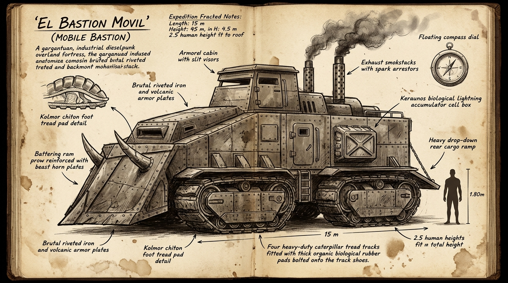

# 🚜 Bastión Móvil de Convoy



---

## 1. Identificación y Rol Operativo

| Campo | Dato |
|---|---|
| Nombre técnico | Bastión Móvil de Vanguardia (Transporte Pesado Acorazado) |
| Apodos de frontera | La Muela de Acero, El Vagón Rompedor, El Trineo Negro |
| Origen | Fábricas de ensamble y arsenales del Gobierno en las Sombras (Puerto Raíz y bases avanzadas) |
| Función primaria | Nodriza de convoy, rompe-rutas en selva virgen, transporte pesado de contingentes militares y civiles |
| Tripulación operativa | 3 mínimos en cabina (Conductor, Mecánico/Fogonero, Vigía/Navegante) + 30 a 40 personas en bodega |

---

## 2. Dimensiones y Masa (Escala Humana 1,80 m)

| Parámetro | Medida |
|---|---|
| Longitud total (con ariete) | 15 metros |
| Anchura de vía | 4,8 metros |
| Altura a la cúpula de cabina | 4,5 metros (caben 2,5 humanos apilados verticalmente) |
| Masa en vacío | 48 toneladas |
| Masa máxima en carga | 65 toneladas |
| Velocidad de avance | 35 a 55 km/h en terreno quebrado; hasta 75 km/h en pista afirmada |

---

## 3. Arquitectura y Mecánica Pesada

- **Chasis y Blindaje:** Estructura de vigas de acero al carbono remachadas en caliente, forrada con planchas dobles de 30 a 50 mm y refuerzos perimetrales de basalto laminado.
- **Ariete en V de Vanguardia:** Quilla frontal angulada diseñada para apartar vegetación leñosa, partir empalizadas y desviar rocas sueltas. La punta monta defensas de queratina volcánica pesada (cosechada de fauna de cresta).
- **Tracción Mixta en 4 Orugas Independientes:** Dos bogies dobles de oruga pesada. Cada tren de rodaje es independiente, permitiendo virajes cerrados por frenado diferencial.
- **Planta Motriz:** Turbina pesada de vapor sobrecalentado combinada con cámara de combustión de resinas fósiles y carbón mineral. Doble chimenea vertical con filtros apagachispas para evitar incendios accidentales en la atmósfera hiperoxigenada.
- **El Embrague de Precarga Mecánica:** Carece de servodirección o asistencia hidráulica ligera. El acoplamiento del volante de inercia en frío exige un golpe de impacto mecánico violento sobre el pedal (imposible para una persona común sin descargar Flujo de choque).

---

## 4. Biotecnología Cosechada Integrada

El Bastión Móvil es el ejemplo supremo de cómo la frontera aprovecha los órganos de la fauna de Extramuros:

1. **Zapatas de Oruga de Kólmor (*Q'ara Llip'i*):**
   - Cada teja de la oruga lleva atornillada una zapata de 15 cm de pie conjuntivo muscular de *Kólmor*.
   - El material no-newtoniano amortigua el impacto en roca viva, no se raja con lajas de pedernal y agarra en fango húmedo sin resbalar.
2. **Juntas de Estanqueidad de Tigmo (*T'uqu Hap'iq*):**
   - El tejido muscular del esfínter labial de *Tigmo* se troquela para sellar los émbolos y válvulas de inyección de vapor a alta presión, resistiendo hidrocarburos pesados sin fugar compresión.
3. **Módulos Acumuladores de Keraunos (*Illapa Asiru*):**
   - Cajones blindados en los costados que albergan bloques de electrocitos secos. Durante las tormentas eléctricas, un mástil retráctil absorbe descargas atmosféricas para alimentar reflectores de penetración de niebla y defensas perimetrales.
4. **Navegación por Core de Gólem (*Rumi Kawsay*):**
   - La cabina de mando aloja una brújula de afinidad biológica: una lasca de *Rumi Kawsay* suspendida en aceite mineral que marca la posición del Core madre de Puerto Raíz, inmune a las fallas magnéticas locales.

---

## 5. Distribución Interior

```
[ QUILAT / ARIETE FRONTAL ]
            │
[ BANCADA DE TURBINA Y CALDERA ]
            │
[ CABINA DE MANDO BLINDADA ] ──> Puesto de conducción elevado con visores de rendija de cuarzo,
                                palancas de oruga gemelas, brújula biológica y pedal de embrague pesado.
            │
[ BODEGA CENTRAL / ALOJAMIENTO ] ──> Espacio diáfano con cuadernas remachadas y bancos corridos.
                                    Capacidad para 35 civiles hacinados con pertrechos.
            │
[ RAMPA TRASERA ABATIBLE ] ──> Portón pesado de apertura por cabrestante para carga y descenso rápido.
```

---

## 6. Papel en la Novela

- **Nodo 2.4 (Fuga de Puerto Raíz):** Tras el derrumbe de las costillas fósiles provocado por los Segadores, Leo alcanza este vehículo atestado de civiles. Encuentra a Nina en los interruptores y a Makusi forcejeando con el pedal trabado. Leo descarga su Flujo en los cuádriceps, encaja el embrague y el Bastión embiste la empalizada de la ciudad para huir a la selva.
- **Nodo 3.1 (La Gran Travesía):** El vehículo sirve como base rodante del trío (Leo, Makusi, Nina) y refugio de las familias evacuadas, hasta que una de sus orugas cae en un campo de fosas de *Tigmo*, obligando a defenderlo a pie de tierra.
