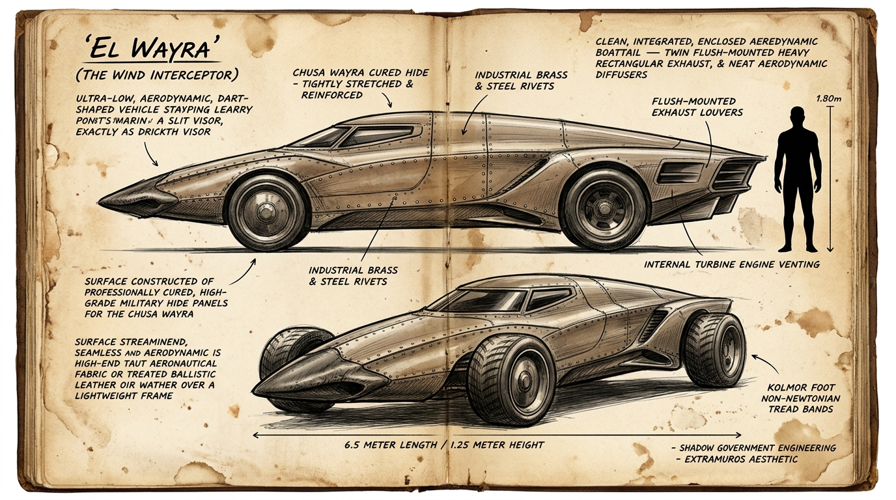

# 🏎️ Interceptor de Vanguardia «Wayra»



---

## 1. Identificación y Rol Táctico

| Campo | Dato |
|---|---|
| Nombre técnico | Interceptor Terrestre de Asalto Ligero «Wayra» (*Viento*) |
| Nombre en clave militar | Modelo I-300 / Bólido de Brecha |
| Origen | División Mecánica del Gobierno en las Sombras (Cuerpo de Contención) |
| Función primaria | Reconocimiento a alta velocidad, intercepción de convoyes fugitivos, patrulla de caminos afirmados y enlace rápido entre puestos fortificados |
| Dotación | 1 piloto (monoplaza en posición semiyacente) o configuración tándem para artillero de lanza neumática |

---

## 2. Dimensiones y Masa (Escala Humana 1,80 m)

| Parámetro | Medida |
|---|---|
| Longitud total | 6,5 metros |
| Anchura de vía | 2,3 metros |
| Altura máxima al techo | 1,25 metros (llega al bajo pecho o cintura de un humano de 1,80 m) |
| Masa en orden de marcha | 1.950 kg (chasis tubular aligerado) |
| Velocidad operativa | 280 a 350 km/h en pistas y lechos secos de río; hasta 380 km/h en recta abierta |

---

## 3. Biomecánica y Materiales Cosechados Integrados

El Wayra replica mecánicamente la fisiología extrema del depredador de Clase B-alta *Ch'usa Wayra* («El Viento Vacío»), incorporando tanto materiales ya catalogados como elementos biológicos especializados:

```
[ DIFUSORES DE CAVITACIÓN (Ch'usa Wayra) ] ──> Rompen el drag y clavan el morro al suelo
[ RADIADOR DE LINFA ENDOTÉRMICA ]         ──> Enfría la turbina de 3.000 CV sin hervir
[ BANDAS DE RODADURA MACIZAS (Kólmor) ]    ──> Tejido muscular no-newtoniano impinchable
[ TIRANTES DE DIRECCIÓN (Tendón 4G) ]      ──> Flexibilidad biológica sin fatiga metálica
[ DIAL DE VIBRACIÓN (Tigmo) ]             ──> Sonda sísmica mecánica en salpicadero
```

### A. Materiales Catalogados en Canon
1. **Fuselaje Militar de Piel Cosechada (*Ch'usa Wayra*):**
   - La carrocería no utiliza chapa metálica ordinaria ni costuras rústicas: son **paneles de dermis balística tratada de *Ch'usa Wayra***, montados a tensión extrema sobre el bastidor interno y fijados al ras mediante remaches mecánicos de acero y bronce.
   - Proporciona un acabado aerodinámico liso y hermético, similar a un tejido aeronáutico militar pero con la resistencia de una piel blindada que absorbe la onda sónica y la grava volcánica a 350 km/h.
2. **Refrigerante de Linfa Endotérmica (*Ch'usa Wayra*):**
   - La turbina compacta trasera de 3.000 CV trabaja a temperaturas que fundirían un bloque de aleación convencional bajo la atmósfera hiperoxigenada.
   - El circuito cerrado de linfa vascular absorbe calor masivo sin entrar en ebullición ni generar burbujas de gas.
3. **Popa Aerodinámica Integrada y Toberas Difusoras:**
   - La planta motriz queda completamente encapsulada dentro del fuselaje en cola de pato (*boattail*), expulsando los gases y el flujo de aire laminar a través de toberas rectangulares enrasadas y branquias de escape de alta presión.
4. **Bandas de Rodadura Continuas (*Kólmor*):**
   - Ruedas macizas forradas con el pie muscular de *Kólmor*. Absorben impactos de pedernal cortante a 300 km/h y se endurecen instantáneamente ante la cizalla.
5. **Sensores de Vibración de Salpicadero (*Tigmo*):**
   - Transductor mecánico pasivo en cuadrante de bronce con filamentos de *Tigmo* suspendidos en aceite mineral; alerta al piloto de fallas tectónicas o pisadas de megafauna a 25-30 m a través de la niebla.

### B. Materiales y Tejidos Pendientes de Catalogación de Especie `[PENDIENTE]`
1. **Tirantes y Trapecios de Suspensión de Tendón Biológico (Tendón 4G):**
   - `[ESPECIE PENDIENTE]`: Cosechado del paquete cervical de un gran herbívoro corredor o depredador de choque. Evita la fractura por fatiga de los brazos de suspensión al soportar virajes de más de 4G laterales.
2. **Visor de Rendija en Cuarzo Volcánico:**
   - Óptica de hendidura estrecha integrada directamente en el morro de cuero, resistente a esquirlas de grava a 350 km/h.

---

## 4. Doctrina Operativa Militar: El Tridente de Caza

El Gobierno en las Sombras despliega los Wayra siguiendo la pauta biológica de la manada de *Ch'usa Wayra*:

* **Despliegue Invariable en Tríada:** Nunca opera un Wayra solitario; se mueven en grupos de tres vehículos a 120° de formación.
* **La Maniobra de Vórtice:** Al interceptar a un convoy o a una presa titánica, los tres vehículos rodean el objetivo alternando pasadas a 300 km/h. Los difusores combinados generan una depresión de aire localizada que desestabiliza la dirección del blanco y lo fuerza a salirse de la pista.

---

## 5. El Factor Humano: La Conducción en Flujo

* Un ser humano corriente del Archipiélago o un civil sin Flujo **no puede pilotar un Wayra**:
  - Las fuerzas de aceleración y los virajes a más de 300 km/h provocan visión negra (blackout) y pérdida del conocimiento en segundos.
  - La velocidad de procesamiento cerebral de una persona normal es demasiado lenta para esquivar una raíz de basalto a esa velocidad.
* **Los Pilotos de Contención:** Soldados entrenados que mantienen voluntariamente un Caudal basal activo durante la conducción (pupilas dilatadas, frecuencia refleja hiperacelerada y musculatura tensada para soportar las fuerzas G).
